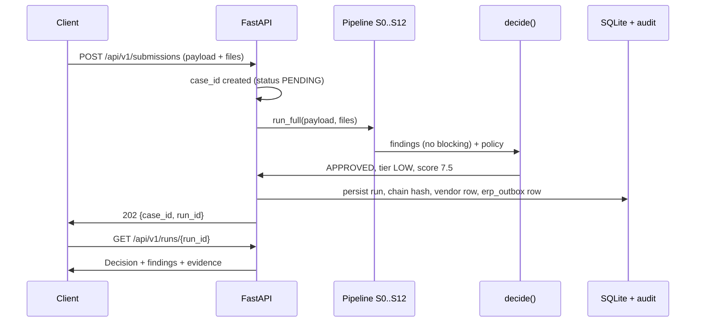

# VendorGate

VendorGate is an evidence-first vendor-onboarding decision engine. It accepts a structured vendor submission plus supporting documents, runs it through a deterministic check pipeline (completeness, format and checksum validation, external verification, cross-field consistency, duplicate and network analysis, sanctions and adverse-media screening), and outputs a decision — APPROVED, PENDING, or REJECTED — with check-by-check findings, evidence, a risk score, required actions, and counterfactuals. The single design idea that makes it different: the pipeline produces claims and findings, and the decision is a pure function of findings plus policy. A bounded language model extracts document text, classifies documents, and adjudicates gray-zone name pairs; it can add findings and raise severity, but it cannot approve a vendor, change a score, or write to the audit chain.

On a frozen 260-case test split, E1 (critical false-approve rate) = 0/109, upper bound 3.4% (source: `eval/reports/latest.json`, key `test_hybrid.E1_critical_false_approve`). Four limitations are documented in §11.

## Table of contents

1. [What this project is](#2--what-this-project-is)
2. [Quickstart](#3--quickstart)
3. [The 10-minute self-test](#4--the-10-minute-self-test)
4. [Architecture](#5--architecture)
5. [Repository layout](#6--repository-layout)
6. [Personas](#7--personas)
7. [Interacting with the environment](#8--interacting-with-the-environment)
8. [Testing and eval — what "train/test" means here](#9--testing-and-eval--what-traintest-means-here)
9. [How to evaluate yourself](#10--how-to-evaluate-yourself)
10. [Results and limitations](#11--results-and-limitations)
11. [Operating the system](#12--operating-the-system)
12. [Contributing and extending](#13--contributing-and-extending)
13. [Roadmap](#14--roadmap-not-built)
14. [Reference](#15--reference)

## 2. What this project is

Procurement teams onboard vendors before first payment. Each onboarding requires checking that the submission is complete, that identifiers are well-formed and check out against registries, that names and addresses are consistent across the form, tax documents, and bank letter, that the vendor is not a duplicate or a front for an existing one, and that no sanctions, politically exposed person, or adverse-media hit applies. Misses mean fraud losses or compliance findings; over-caution means weeks of back-and-forth for legitimate suppliers.

A submission is a structured JSON form (requester block, company block, tax block, bank block, document declarations, attestations) plus the referenced document files, typically a W-9 or GST/VAT certificate, a bank letter, and, for higher tiers, incorporation certificates and certificates of insurance. The golden fixtures in `backend/tests/golden/fixtures/` are the canonical examples: `hp-1.json` is a clean US supplier, `ec-1-run-1.json` is the same company written three different ways across form, tax document, and bank letter.

A decision is a `Decision` object (`backend/app/domain/models.py`): a status, an awaiting set (VENDOR, INTERNAL, or empty), a risk tier and score breakdown, reason codes for every blocking finding, required fix actions, an approval route for pending-internal cases, and counterfactuals — minimal fix sets that would flip the decision, computed by re-running the pure decision function with findings removed. Findings carry evidence pointers (claim, rule, adapter, policy, or LLM explain-only) and every run is hash-chained into an append-only audit log verifiable at `/api/v1/cases/{case_id}/audit/verify`.

What is deliberately not built: real payments, real verifier integrations (every external check sits behind the Verifier Protocol in `backend/app/adapters/base.py` with deterministic mocks in `backend/app/adapters/mocks/`), real ERP write-back (the outbox row is simulated), and LLM-approved decisions (the model has no path to APPROVED). The limits are listed without softening in §11.

This is for seven personas: the vendor who submits, the requester who submits on a vendor's behalf, the AP analyst who clears vendor-side findings, the controller and compliance officers who approve gated tiers and resolve sanctions, the auditor who verifies the chain, and the interviewer or judge who attacks the system in the Fool-it Lab and reads the Benchmark page. See §7.

A reader should care about one thing: this is a case study in bounded-LLM verification — deterministic checks own every load-bearing judgment, the model owns extraction and adjudication under replayable fixtures — not a production SaaS.

## 3. Quickstart

Expected total time: under 10 minutes on a machine with the prerequisites installed.

### 3.1 Prerequisites

| Requirement | Version | Install |
|---|---|---|
| Python | 3.12.x (`requires-python = ">=3.12,<3.14"` in `pyproject.toml`) | `python3.12 --version` must print 3.12 |
| Node | 20+ | `node --version` |
| Tesseract (OCR for scanned documents) | 5+ | `apt install tesseract-ocr` / `brew install tesseract` |
| Docker (only for the container path) | any recent | `docker info` must succeed |
| `uv` | any recent | `curl -LsSf astral.sh/uv/install.sh \| sh` |

No language-model API key is required. The demo, the test suite, and the evaluation all run in `LLM_MODE=replay`, which serves recorded model responses from fixtures. Live calls are never made unless `LLM_MODE` is set to `live` or `record`.

### 3.2 Local run

```bash
git clone <repo> && cd VendorGate
cp .env.example .env            # LLM_MODE=replay, CLOCK_MODE=virtual
make setup                      # installs Python deps (uv), frontend deps (npm)
alembic upgrade head            # creates data/vendorgate.db
uvicorn backend.app.main:app --port 8000
```

Expected output:

- `cp` is silent.
- `make setup` prints uv sync output, then npm install output (ending with an `npm audit` note), then `pre-commit: command not found` at most — the trailing `|| true` in the Makefile makes the hook optional.
- `alembic upgrade head` prints `Running upgrade ... -> <rev>` on a fresh database, and nothing when already at head (the command in §3.2 runs against a fresh `data/`).
- `uvicorn` prints `Uvicorn running on http://127.0.0.1:8000`.

In a second shell for the UI:

```bash
npm --prefix frontend install
npm --prefix frontend run dev   # Vite on :5173, proxies /api to :8000
```

(`make dev` runs both processes; the two commands above are the same steps spelled out.)

### 3.3 Container run

```bash
docker build -t vendorgate .
mkdir -p data
docker run -e LLM_MODE=replay -e CLOCK_MODE=virtual -p 8000:8000 -v $(pwd)/data:/app/data vendorgate
```

The volume mount matters: the default `DATABASE_URL` is the relative path `sqlite:///data/vendorgate.db`, which resolves to `/app/data/` inside the image (`Dockerfile`, `WORKDIR /app`). Without the mount, startup fails with `sqlite3.OperationalError: unable to open database file`. The image build takes several minutes on first run (frontend build plus Python dependencies). Container cold start — image present, `docker run` to `/readyz` returning `{"ok":true}` — measured 1 second. (There is no `docker-compose.yml` in the repo; `make demo` references one and does not run as written. Use the three commands above.)

### 3.4 First 60 seconds

Open `http://localhost:8000`. The page shows the heading "VendorGate dashboard", a Runs table (empty on a fresh database), and links for New submission, Benchmark, Fool-it Lab, and Policy. The dashboard has no pre-seeded cases; every case in the walkthrough below is created by the commands in §4.

After completing §4, the Runs table lists the HP-1, EC-1 v1, and EC-1 v2 runs with their statuses, and `/benchmark` renders the frozen numbers from `eval/reports/latest.json`. The dashboard itself reads only runtime store state (`GET /api/v1/metrics/dashboard`); it never reads eval files.

To stop: Ctrl-C the uvicorn process (and the Vite process). Runtime state persists in SQLite; `POST /api/v1/admin/reset` clears it without touching code, policy, or fixtures.

## 4. The 10-minute self-test

This walkthrough takes about 10 minutes with the server running; add 5 minutes if you need `make setup`. It uses EC-1 ("three spellings, one company") because one flow exercises name matching, adjudication, resubmit, delta re-evaluation, and the audit chain. All commands assume `localhost:8000`. Replace `<case_id>` and `<run_id>` with the values the API returns.

Step 0 — Start from a clean database (optional but recommended).

```bash
curl -X POST localhost:8000/api/v1/admin/reset
# {"ok": true, "duration_ms": 12}
```

Reset wipes cases, runs, messages, and the check cache. The dashboard Runs table returns to empty. Skip this step to keep existing cases; the walkthrough creates new ones either way, and every `Idempotency-Key` below is fresh.

Payloads come from the committed golden fixtures, so every expected value below is reproducible. File uploads use `file:<doc_id>` multipart fields; the payload goes in the `payload` field.

Step 1 — Submit HP-1 (clean happy path).

```bash
python3 - <<'EOF'
import json, urllib.request, uuid
B = 'BND' + uuid.uuid4().hex[:8]
hp1 = json.load(open('backend/tests/golden/fixtures/hp-1.json'))['payload']
body = (f'--{B}\r\nContent-Disposition: form-data; name="payload"\r\n\r\n{json.dumps(hp1)}\r\n--{B}--\r\n').encode()
req = urllib.request.Request('http://localhost:8000/api/v1/submissions', data=body,
    headers={'Content-Type': f'multipart/form-data; boundary={B}', 'Idempotency-Key': str(uuid.uuid4())}, method='POST')
print(json.load(urllib.request.urlopen(req)))
EOF
# {"case_id": "<case_id>", "run_id": "<run_id>"}
```

Save both ids — every later step addresses the case or the run. Reusing an `Idempotency-Key` returns the original response instead of creating a duplicate case; the resubmit steps below rely on fresh keys per attempt.

Then:

```bash
curl http://localhost:8000/api/v1/runs/<run_id> | jq '.decision.status, .decision.score.total'
# "APPROVED"
# 7.5
```

Expected: `decision.status` is `APPROVED`, `decision.score.total` is `7.5`, `decision.reason_codes` is empty. (Source: `backend/tests/golden/fixtures/hp-1.json`.)

Step 2 — Submit EC-1 v1 (three spellings). Same command with `backend/tests/golden/fixtures/ec-1-run-1.json` as the payload file. Expected:

```bash
curl http://localhost:8000/api/v1/runs/<run_id> | jq '.decision.status, .decision.awaiting, .decision.reason_codes'
# "PENDING"
# ["VENDOR"]
# ["LEGAL_FORM_UNCONFIRMED"]
curl http://localhost:8000/api/v1/runs/<run_id> | jq '.decision.counterfactuals[0]'
# {"fix_set": ["UPLOAD_DBA_PROOF"], "status": "APPROVED", "tier": "LOW", ...}
```

The single blocking item is C-NAME-02 (form says one legal form, bank letter says another, no corroborating document). The counterfactual says one fix flips the case to APPROVED.

Step 3 — Open the case page.

```text
open http://localhost:8000/cases/<case_id>
```

[Screenshot: case page showing PENDING badge with tier LOW and score 15.0.]

The case page reads `GET /api/v1/cases/<case_id>` (case with current decision) and `GET /api/v1/runs/<run_id>` (full pack: findings, evidence, counterfactuals, events). The status header combines `decision.status` with `decision.tier` and `decision.score.total`; the awaiting badges come from `decision.awaiting`. Everything below the header is a direct rendering of the run pack — no separate view model, so the page cannot disagree with the API.

The page shows: a PENDING header with tier and score; a "Blocking items (1)" section naming legal-form confirmation; a "Counterfactuals" section with the UPLOAD_DBA_PROOF fix; a Findings tab where the C-NAME-02 row expands to show evidence entries (`[claim]`, `[rule]`, `[llm] ... (explain-only)`); tabs for message, network, and audit; and a "Verify chain" button in the Audit tab.

The message tab shows the vendor-facing remediation message (subject plus body, rendered from templates with LLM polish marked best-effort), the checker verdict ("clean" when no forbidden terms fire), and the fix-item list with fix codes. The network tab embeds the first document and either names the matched vendor rows with their shared attributes (for C-DUP findings) or states "No shared-attribute clusters for this case." The audit tab lists the nudge/appeal/closure/attempt events and the "Verify chain" button, which reports chain ok with the event count.

Step 4 — Resubmit with the incorporation certificate. The bytes live in the committed fixture (`ec-1-resubmit.json`, `files` map); decode them once:

```bash
python3 - <<'EOF'
import json, base64
r = json.load(open('backend/tests/golden/fixtures/ec-1-resubmit.json'))
for doc_id, (fn, b64) in r['files'].items():
    open(f'/tmp/{doc_id}_{fn}', 'wb').write(base64.b64decode(b64))
EOF
```

Then resubmit (note the `file:<doc_id>` field names and the `If-Match: 1` version guard):

```bash
python3 - <<'EOF'
import json, urllib.request, uuid
cid = '<case_id>'
resub = json.load(open('backend/tests/golden/fixtures/ec-1-resubmit.json'))['payload']
B = 'BND' + uuid.uuid4().hex[:8]
parts = [f'--{B}\r\nContent-Disposition: form-data; name="payload"\r\n\r\n{json.dumps(resub)}\r\n'.encode()]
for doc_id, fn in [('w9','/tmp/w9_w9_ec1.pdf'), ('bank','/tmp/bank_bank_hp1.pdf'), ('inc','/tmp/inc_incorp_ec1_resubmit.pdf')]:
    parts.append(f'--{B}\r\nContent-Disposition: form-data; name="file:{doc_id}"; filename="x.pdf"\r\nContent-Type: application/pdf\r\n\r\n'.encode() + open(fn,'rb').read() + b'\r\n')
body = b''.join(parts) + f'--{B}--\r\n'.encode()
req = urllib.request.Request(f'http://localhost:8000/api/v1/cases/{cid}/resubmit', data=body,
    headers={'Content-Type': f'multipart/form-data; boundary={B}', 'If-Match': '1', 'Idempotency-Key': str(uuid.uuid4())}, method='POST')
print(json.load(urllib.request.urlopen(req)))
EOF
# {"case_id": "<case_id>", "run_id": "<new_run_id>", "new_version": 2}
```

Expected on the new run:

```bash
curl http://localhost:8000/api/v1/runs/<new_run_id> | jq '.decision.status, .decision.score.total, .delta'
# "APPROVED"
# 9.75
# {"rerun": 10, "cached": 38, "resolved": ["C-NAME-02"], "introduced": [], "changed_paths": [...]}
```

Only the checks affected by the changed documents re-ran (10 of 48); the rest were served from the check cache. The resolved list contains exactly C-NAME-02.

Three resubmit responses to know:

| Response | Meaning |
|---|---|
| `202 {case_id, run_id, new_version}` | accepted; fetch the run for decision + delta |
| `409 {"type": "NO_CHANGES"}` | payload identical to current version; nothing to re-run |
| `412 {"type": "VERSION_MISMATCH"}` | `If-Match` did not equal the current version; refetch and retry |
| `403 {"type": "NOT_RESUBMITTABLE"}` | case is not PENDING (already APPROVED or REJECTED) |

If step 4 returns 409, the resubmit payload matched version 1 byte-for-byte on the compared paths — check that the `files` were actually attached (`file:<doc_id>` fields) rather than declared. If it returns 412, pass the `current_version` from the response body as the next `If-Match` value.

If any step's output differs from the expected values above, in order of likelihood: (1) the database was not fresh and an `Idempotency-Key` was reused — reset and use new keys; (2) `LLM_MODE` is not `replay` — check `.env`, live model output is not deterministic; (3) files were declared but not attached — the `file:<doc_id>` field names must match the payload's `documents[].doc_id` exactly, otherwise ingestion sees declared-but-absent documents and S2 blocks; (4) the policy was edited — `GET /api/v1/policy` shows the hash, and the goldens assume the committed policy.

A full APPROVED run object is worth reading once. `GET /api/v1/runs/<run_id>` returns the run pack:

```json
{
  "case_id": "457ff8a3fb0e",
  "run_id": "873ca8a23ed",
  "decision": {
    "status": "APPROVED",
    "awaiting": [],
    "tier": "LOW",
    "score": {"total": 9.75, "band": "LOW", "components": {"SPEND": {...}, "GEO": {...}, "DOCS": {...}, "BANK_ID": {...}, "CATEGORY": {...}, "REGISTRY_MEDIA": {...}}},
    "reason_codes": [],
    "approval_route": [],
    "counterfactuals": [],
    "policy_version": "2026.11.1",
    "engine_version": "1.0.0",
    "reproducibility_hash": "<sha256>"
  },
  "findings": [{"check_id": "C-VER-02", "stage": "S4", "outcome": "PASS", "evidence": [...], "cached": true, "duration_ms": 1}],
  "delta": {"rerun": 10, "cached": 38, "resolved": ["C-NAME-02"], "introduced": [], "changed_paths": [...]},
  "events": [...]
}
```

`cached: true` on a finding means it was served from the check cache (fingerprint match); `duration_ms` is measured per check and feeds the E18 latency metric. `reproducibility_hash` covers the decision inputs; equal hashes on rerun is the E15 determinism claim made checkable.

Step 5 — Verify the audit chain.

```bash
curl http://localhost:8000/api/v1/cases/<case_id>/audit/verify | jq .
# {"ok": true, "length": 7}
```

`ok: true` means every run, event, and decision in the case re-hashes to the stored chain head. `length` grows with versions and events.

Step 6 — Try to fool it.

```text
open http://localhost:8000/foolit
```

[Screenshot: Fool-it Lab with HP-1 selected, M-06 toggled, result card showing the expected-vs-actual comparison.]

Pick base vendor HP-1, toggle M-06 (GSTIN/PAN mismatch), press "Run through pipeline". Expected result card: "Operator says the system should: PENDING (GSTIN_PAN_MISMATCH). System did: ✓ match." (The match is on status and awaiting party; the exact reason codes differ because HP-1 is a US vendor, so the GSTIN-shaped value trips format checks on the way to the same PENDING(VENDOR) outcome.) Toggle M-06 off, toggle M-08 (legal-form variant, control operator). Expected: "Operator says APPROVED. System did: ✓ match." The "critical approvals" counter at the top remains 0. Each attempt is stored with `source: redteam` (`eval/reports/redteam.jsonl`).

Step 7 — Look at the benchmark.

```text
open http://localhost:8000/benchmark
```

[Screenshot: Benchmark page headline tile E1 0.0% (0/109), upper bound 3.4%.]

The E1 tile reads "0.0% (0/109)" with a 95% upper bound of 3.4%. Scroll to the Limitations section: the four honest limitations are visible on the page (quoted verbatim in §11).

The rest of the page, top to bottom: the headline tile (E1 with k/n and upper bound); the frozen test-split metrics table (E2, E3, E4, E7, E20, E5, E6 micro-F1 and exact-set, E13, E14, E16, E21, E18 p50/p95); the 3×3 confusion table (expected rows vs actual columns); the 7-mode ablation table with an llm-only test-slice row; the name-pair / extraction / network JSON block; the Limitations list; and a one-line dataset manifest reference (dataset hash, split hash, seed) with the synthetic-data note. Every number on the page is rendered from `/api/v1/eval/latest`, which serves `eval/reports/latest.json` verbatim.

## 5. Architecture

### 5.1 The system at a glance

```text
Browser (Vite :5173)
  |  REST /api/v1  +  SSE run events
  v
FastAPI (backend/app/main.py :8000)
  |
  +-- Pipeline S0..S12 (backend/app/pipeline/)
  |     +-- Adapters, all mocked (backend/app/adapters/mocks/)
  |     +-- LLM, replay-only in demo (backend/app/llm/)
  +-- Policy YAML (policy/)
  +-- SQLite (data/vendorgate.db) + hash-chained audit
```

The full stage DAG, including the S0 fan-out and the S5/S8/S2/S9 convergence into S10, is drawn in `docs/process_map.md`. What follows is the one-paragraph-per-stage version.

### 5.2 The pipeline, stage by stage

- **S0 Intake & normalize** (`backend/app/pipeline/stages/s0_intake.py`): validates the submission against the schema, assigns NEW_VENDOR vs CHANGE_REQUEST mode, and converts every field into claims (raw plus canonical value). Emits claims; feeds every later stage.
- **S1 Document ingestion & extraction** (`s1_docs.py`): sniffs uploads, extracts the text layer (OCR fallback via Tesseract), classifies the document type by anchors, scans for injection patterns, runs deterministic regex extractors, and calls L1 extraction for the rest. Emits doc claims; feeds S2, S3, S5.
- **S2 Completeness & applicability** (`checks/req.py`): evaluates the jurisdiction pack's required fields and documents under the policy's `when` predicates. Emits MISSING_FIELD / MISSING_DOC / MISSING_CONDITIONAL; feeds S9 risk and S10.
- **S3 Format & checksum validation** (`checks/tax.py`, `checks/bank.py`, contact checks): country-aware shape and checksum checks (EIN, GSTIN, PAN, VAT, IBAN, ABA, IFSC, SWIFT, phone, email). Emits TAX_* / BANK_* / CONTACT_*; feeds S4 and S5.
- **S4 External verification** (`checks/ver.py`): IRS TIN match, GST registry, VIES, company registry, bank ownership — each through the Verifier Protocol (`backend/app/adapters/base.py`) against deterministic mocks. An unavailable verifier yields UNVERIFIABLE, never PASS. Emits VER_* or VERIFIER_UNAVAILABLE; feeds S5.
- **S5 Cross-field consistency** (`checks/name.py`, `checks/geo.py`, tax/ID checks): name vs bank holder vs tax record, incorporation-date vs registry year (same-registry only), tax country vs company vs bank country, PO box and remit-address rules. Emits NAME_* / GEO_* / INCORP_DATE_MISMATCH; gray pairs are enqueued for S8; feeds S8 and S9.
- **S6 Duplicate & network analysis** (`checks/dup.py`, `backend/app/network/graph.py`): exact TIN reuse, bank-account sharing, near-duplicate scoring, phone-cluster graph, bank-change velocity on existing vendors. Emits DUPLICATE_* / BANK_SHARED_* / CHANGE_VELOCITY; feeds S9 and S10.
- **S7 Risk screening** (`checks/san.py`, `backend/app/screening/`): sanctions entity/person ladder (confirm 0.97, potential 0.85, decoy contradiction rule), PEP, adverse media, embargoed jurisdiction. Sanctions findings are never adjudicated away. Emits SAN_* / PEP_* / ADVERSE_*; feeds S8 and S10.
- **S8 Gray-zone adjudication** (`stages/s8.py`, `backend/app/decision/adjudication.py`): the single bounded-LLM judgment point. L3 verdicts (SAME / LIKELY_SAME / DIFFERENT / UNSURE, order-swap-consistent) can only lower severity when a deterministic corroborator (e.g., an incorporation certificate naming the variant) is present; otherwise the finding stands. Emits WARNs or stands; feeds S9 and S10.

Concretely, EC-1 v1 flows through S8 like this: S5 compares the canonical form name against the canonical bank-holder name, gets relation FORM_CONFLICT with no corroborator on file, and enqueues an adjudication request. S8 calls L3 (replay hit in demo), receives SAME with high confidence — and the finding still stands, because there is no corroborator. `apply_adjudication` returns the finding unchanged except for appended LLM evidence marked explain-only. The case stays PENDING(VENDOR) with LEGAL_FORM_UNCONFIRMED. On resubmit, the incorporation certificate arrives, the K3 corroborator check (`_k3` in `checks/name.py`) finds the certificate naming the holder variant, and the same L3 verdict now lowers C-NAME-02 to WARN with reason NAME_VARIANT_EXPLAINED. Nothing about the model changed between the two runs; the corroborator did. That is asymmetric authority made mechanical.
- **S9 Risk scoring & tiering** (`backend/app/risk/`): six weighted components (SPEND 25, GEO 20, DOCS 20, BANK_ID 15, CATEGORY 10, REGISTRY_MEDIA 10; `policy/base.yaml`) over facts, never over LLM prose. Emits RiskBreakdown and tier; feeds S10.
- **S10 Decision, routing, counterfactuals** (`backend/app/decision/engine.py`): `decide()` — a pure function of findings and policy — maps blocking findings to APPROVED / PENDING / REJECTED, computes the approval route, and enumerates counterfactual fix sets. Emits Decision; feeds S11 and S12.
- **S11 Communications** (`backend/app/comms/`): renders vendor and internal messages from Jinja templates and scans every rendered message against forbidden terms (`forbidden_vendor_terms` in `policy/base.yaml`). Emits outbox rows; feeds S12.
- **S12 Persist & audit** (`backend/app/persistence/`): stores the run, chains its hash into the case audit log, writes the ERP outbox row on approval. Emits the verifiable chain; feeds nothing further.
- **S13 Resubmit, clock, scheduler** (Phase 4): delta re-evaluation (only changed-path checks re-run), virtual-clock advance, nudges, deadlines, retry limits, appeals. Runs on demand via `/resubmit` and `/admin/clock/advance`.

### 5.3 The three design invariants

- **Claims → Findings → Decision.** `decide()` is a pure function of `(findings, policy)`; swapping thresholds changes outcomes without touching checks. Reference: ADR-0001 (`docs/adr/0001-hybrid-engine.md`), `backend/app/decision/engine.py`.
- **Asymmetric authority.** The LLM can add findings and raise severity; it can lower severity only with a deterministic corroborator (`backend/app/decision/adjudication.py`). L3 order-swap consistency is enforced. Reference: ADR-0011 (`docs/adr/0011-injection-patterns.md`) for untrusted-text handling.
- **Fail-closed.** UNVERIFIABLE is blocking when mandatory (`is_blocking` in `backend/app/decision/engine.py`). No code path converts it to PASS. Reference: ADR-0002 (`docs/adr/0002-fail-closed.md`).

### 5.4 HP-1 sequence (Mermaid, renders on GitHub)



### 5.5 What the LLM does and does not do

| Where used | Never used |
|---|---|
| L1 document field extraction (`backend/app/llm/tasks_l1.py`) | Checksums and format validation |
| L2 document classification assist | Duplicate and network matching |
| L3 name-pair adjudication, order-swap-checked (`tasks_l3.py`) | Sanctions, PEP, adverse-media ladders |
| L4 message polish, forbidden-term scanned after | Status, tier, score, counterfactuals |
| L5 approver brief summarization | Approvals, audit chain, routing |

Model pinning: ADR-0010 (`docs/adr/0010-llm-model-pinning.md`). Injection handling: ADR-0011. Record/replay discipline: ADR-0003 (`docs/adr/0003-record-replay.md`). The demo runs `LLM_MODE=replay`; live calls are never made unless the mode is changed (see §12.2).

## 6. Repository layout

```text
VendorGate/
  backend/app/main.py            FastAPI app: all REST routes, SSE, static dist
  backend/app/domain/            enums + Pydantic models (FROZEN)
  backend/app/core/              policy loader, hashing, safe-eval (FROZEN)
  backend/app/pipeline/          orchestrator, registry.py (FROZEN), stages/, checks/
  backend/app/decision/          decide(), resolutions, counterfactuals, routing
  backend/app/adapters/          Verifier Protocol: base.py (FROZEN) + mocks/
  backend/app/validators/        GSTIN, PAN, IFSC, EIN, ABA, VAT, IBAN, SWIFT, phone
  backend/app/matching/          name normalization, legal forms, similarity
  backend/app/screening/         sanctions, PEP, adverse-media ladders
  backend/app/risk/              six scoring components + tiers
  backend/app/ingest/            upload safety, OCR, injection scan, classifier, regex
  backend/app/comms/             Jinja templates, message checker, outbox
  backend/app/scheduler/         nudge, deadline, expiry jobs
  backend/app/persistence/       SQLAlchemy repos, hash-chained audit, check cache
  backend/app/llm/               provider, cache (live/record/replay), L1..L5 tasks
  frontend/src/                  one .tsx per route (flat, no pages/ dir)
  datagen/                       world.py, render_docs.py, submissions.py, mutations/
  datagen/out/                   world.json, dataset_dev/test.json, manifest.json
  eval/                          run_eval.py, ablation.py, llm_slice.py, metrics.py, reports/
  policy/                        base.yaml, countries/, legal_forms.yaml, fix_hints.yaml
  docs/                          process_map.md, assumptions.md, decisions.md, adr/
  backend/tests/                 unit, property, contract, api, component, chaos,
                                 golden, determinism, e2e, datagen, eval, fixtures
```

Frozen-contract rule: any file under `backend/app/domain/`, plus `backend/app/pipeline/registry.py`, `backend/app/adapters/base.py`, `backend/app/core/hashing.py`, and `backend/app/core/safe_eval.py`, is a one-way door — changing it requires an ADR. Each of these paths exists; verify with `test -e` before editing.

## 7. Personas

| Persona | What they do | What they see | Role header |
|---|---|---|---|
| Vendor | Self-submits, reads pending reasons, resubmits | /submit, /runs/:id, case page, resubmit form | (none / VENDOR) |
| Requester | Submits on behalf of a vendor | /submit (requester block), /cases/:id read-only | REQUESTER |
| AP Analyst | Triages PENDING(VENDOR), retries verifiers, resolves duplicates | /approvals (AP_ANALYST queue), case actions | AP_ANALYST |
| Controller | Approves MEDIUM tiers | /approvals (CONTROLLER queue) | CONTROLLER |
| Compliance | Approves HIGH, resolves sanctions/PEP/adverse, reviews appeals | /approvals (COMPLIANCE), callback desk, appeals queue | COMPLIANCE |
| Auditor | Reads and verifies the audit chain | /cases/:id/audit, /audit/verify | AUDITOR |
| Interviewer/Judge | Attacks via Fool-it Lab, reads Benchmark | /foolit, /benchmark, /policy | (any) |

Vendor — submits at `/submit` with the company, tax, and bank blocks plus document files; sees pending reasons in plain neutral language and the resubmit form with version guarding (`If-Match`). Cannot see other vendors' cases. Cannot see sanctions internals: list hits render as neutral review text.

Requester — an internal employee submitting for a vendor; fills the requester block (name, department, spend, category) in `/submit`. Sees the case read-only and receives the approval email. Cannot edit vendor attestations after submission.

AP Analyst — works the `/approvals` queue filtered to the AP_ANALYST route: retries failed verifiers per case (`/cases/:id/retry-verification`), resolves duplicate and cluster findings, clears document findings after resubmit. Cannot approve tiers and cannot resolve sanctions findings (server returns 403; see `test_resolutions_role_gate` in `backend/tests/api/test_cases.py`, which asserts a 403 for AP_ANALYST on SANCTIONS_REVIEW and a 200 for COMPLIANCE on the same action).

Controller — approves MEDIUM tier and LOW_GATED cases from the CONTROLLER queue. Cannot act as requester or submitter on the same case; segregation of duties is enforced server-side, not just hidden in the UI.

Compliance — approves HIGH tier, resolves SANCTIONS_REVIEW / PEP_REVIEW / ADVERSE_MEDIA_REVIEW, operates the callback desk (attests the independent phone number used), and reviews appeals. The only role that can clear list-related findings.

Auditor — opens `/cases/:id`, switches to the audit tab, presses "Verify chain" (calls `/audit/verify`). Read-only; cannot approve, resolve, or resubmit.

Interviewer/Judge — opens `/foolit`, picks a base vendor, toggles mutation operators, and compares expected vs actual outcomes; opens `/benchmark` for the numbers and `/policy` for assumptions and the policy hash. Nothing to break: the worst outcome is a logged red-team attempt.

Role switching: the demo uses the `X-Role` request header (assumption A-12, `policy/assumptions.yaml`). Every privileged endpoint checks the role server-side.

## 8. Interacting with the environment

### 8.1 Three ways in

- Browser at `localhost:8000` for the UI (routes: `/`, `/submit`, `/runs/:id`, `/cases/:id`, `/approvals`, `/admin`, `/benchmark`, `/foolit`, `/policy`).
- REST API at `localhost:8000/api/v1` (machine-readable contract at `/openapi.json`, snapshot in `backend/tests/contract/fixtures/openapi.json`).
- CLI via make targets: `setup dev lint test coverage test-all e2e ci ci-e2e deploy seed datagen eval-dev eval-test demo` (`Makefile`).

### 8.2 API routes used most

| Method | Path | Returns |
|---|---|---|
| POST | /api/v1/submissions | `202 {case_id, run_id}`; 422 on schema failure |
| GET | /api/v1/runs/:id | run pack: decision, findings, evidence, delta |
| GET | /api/v1/cases | case list with status/tier |
| GET | /api/v1/cases/:id | case with current decision |
| POST | /api/v1/cases/:id/resubmit | `202 {case_id, run_id, new_version}`; 403 unless PENDING, 409 on no changes, 412 on version mismatch |
| GET | /api/v1/cases/:id/audit/verify | `{ok, length}` chain verification |
| POST | /api/v1/foolit/run | `{expected, actual, match}` for operator set |
| GET | /api/v1/eval/latest | contents of `eval/reports/latest.json` |
| GET | /api/v1/policy | assumptions A-01..A-15 plus `policy_hash` |
| POST | /api/v1/admin/reset | wipes runtime state, reseeds (<5s) |
| POST | /api/v1/admin/clock/advance | `{now, jobs_fired}` after advancing N days |

Read-only helpers: `GET /api/v1/schema/submission` (the submission JSON schema), `GET /api/v1/vendors`, `GET /api/v1/cases/:id/docs/:doc_id` (file bytes), `GET /api/v1/cases/:id/messages`, `GET /api/v1/approvals[?role=]`, `GET /api/v1/cases/:id/events` (stored case events), `GET /api/v1/runs/:run_id/events` (SSE stream of run events). The full contract is `/openapi.json`.

### 8.3 The virtual clock

`CLOCK_MODE=virtual` (default in `.env.example`) means deadlines, nudges, and expiries move only when advanced:

```bash
curl -X POST localhost:8000/api/v1/admin/clock/advance \
  -H 'Content-Type: application/json' -d '{"days": 1}'
# {"now": "2026-11-13T06:17:00+00:00", "jobs_fired": {"nudges": [...], "closed": []}}
```

Each advance runs the scheduler (`backend/app/scheduler/jobs.py`): day 1/3/7/10 nudges, day-15 abandonment, retry-limit enforcement. Real wall-clock mode exists but the demo, tests, and eval all use virtual time.

Scheduler semantics, from `policy/base.yaml` (`lifecycle`) and the jobs module: nudges fire on days 1, 3, 7, and 10 after submission while the case is PENDING(VENDOR); each nudge is recorded as a `nudge.sent` case event, so re-advancing over the same days is idempotent — no duplicate messages. Cases idle past the due window transition to ABANDONED (day 15 in the EC-14 golden). Vendor resubmits never extend the due date; the third same-code resubmit trips RETRY_LIMIT_EXCEEDED and routes to appeal, which requires three distinct roles (requester, approver, compliance) — the separation-of-duties rule from A-12, enforced in the appeal endpoint, not the UI.

### 8.4 Resetting

```bash
curl -X POST localhost:8000/api/v1/admin/reset
# {"ok": true, "duration_ms": <5s}
```

Reset clears cases, runs, outbox, and the check cache. It does not touch policy files, fixtures, or code.

## 9. Testing and eval — what "train/test" means here

There is no training. This is not a machine-learning system: no model learns from data, no weights are fitted, and the fixed language model is called with recorded prompts and does not learn from submissions. The "learning" in this repo is (a) check thresholds in `policy/*.yaml` and (b) name-pair labels in `datagen/name_pairs/`. Everything else is code and fixtures.

### 9.1 Splits

| Split | Size | Purpose | Where |
|---|---|---|---|
| dev | 340 cases (60%) | threshold tuning; safe to inspect any time | `datagen/out/dataset_dev.json` |
| test | 260 cases (40%) | FROZEN; one run per policy hash | `datagen/out/dataset_test.json` |
| name pairs | 400 labeled pairs | E12 matcher eval | `datagen/name_pairs/*.jsonl` |
| extraction set | 120 PDFs (60 text, 60 scanned) + ground truth | E11 extraction eval | `datagen/extraction_set/` |
| network set | 15 planted clusters | E14 network eval | `datagen/network_set/clusters.json` |

The freeze mechanism is `test_split_sha256` in `datagen/out/manifest.json`: the harness refuses `--split test` when the file hash differs from the manifest. Retuning creates `test_v2` with fresh seeds; the old result stays in `eval/reports/`.

Test-split composition (source: `datagen/out/dataset_test.json`): 101 APPROVED, 117 PENDING, 42 REJECTED, of which 109 carry the critical flag (sanctions, takeover, injection, outage, and bank-identity operators). Dev split: 163 APPROVED, 136 PENDING, 41 REJECTED, 91 critical. The critical cases are the denominator of E1 in each split.

### 9.2 Where the data lives

- `datagen/out/manifest.json` — composition counts (160 clean / 240 single / 100 double / 60 scanned / 40 adversarial), seeds, dataset and split hashes.
- `datagen/out/world.json` — the 160 seeded synthetic vendors plus sanctions/PEP/adverse fixtures.
- `datagen/out/dataset_dev.json`, `datagen/out/dataset_test.json` — the ~600 cases, each with payload, operator id, side-fixtures (mocks, master rows, fault specs, L1/L3 replay entries), and the expected outcome.
- `datagen/name_pairs/{true_variants,hard_negatives,ambiguous}.jsonl` — 150 same-entity variants, 150 hard negatives, 100 ambiguous pairs awaiting blind human labels (E23 deferred; see L-NEW7).
- `datagen/extraction_set/{text_layer,scanned}/` — 120 PDFs with `ground_truth.json`.
- `datagen/network_set/clusters.json` — 15 clusters of 2–4 vendors sharing bank/phone attributes.

Regenerate everything deterministically with `make datagen` (SEED=42); the manifest hash must match afterwards. Expected tail of output:

```text
world: 160 vendors, sha <world-sha>
dataset: dev=340 test=260 split=6592f24eef07
```

If the split hash differs from `6592f24eef07`, the local generator, seed handling, or operator code drifted from the committed dataset — do not run eval until the hashes agree. Composition of the 600 cases (source: `datagen/out/manifest.json`, `counts`): 160 clean vendors (40 per jurisdiction, low spend, complete documents — the APPROVED baseline), 240 single-operator mutations, 100 double mutations over non-conflicting operator pairs, 60 scanned variants (degraded bank letter, OCR path), 40 hand-built adversarial cases (injection variants, homoglyphs, takeover reuse, fuzzy sanctions). The test split holds the entire adversarial slice plus held-out operator pairs and fresh seeds.

Labels flow one way: operator declaration in `catalog.yaml` → expected outcome stored on the case → metric comparison. The builder (`datagen/build_dataset.py`) contains no reference to the pipeline, the decision function, or the eval runner — the lint test fails the build on any such import. The pipeline never sees a label; it sees payloads and side-fixtures (mock rows, master rows, fault specs, replay entries) installed per case by `eval/case_runner.py`.

### 9.3 How to run the eval

```bash
LLM_MODE=replay python3 -m eval.run_eval --split dev --mode hybrid    # ~3 min, 340 cases
LLM_MODE=replay python3 -m eval.run_eval --split test --mode hybrid   # the frozen run, ~2 min
LLM_MODE=replay python3 -m eval.ablation --split dev --modes=hybrid,rules-only,-corroboration,-fail-closed,-network,-counterfactual --llm-mode=replay
PYTHONPATH=. python3 -m eval.sets_eval                                 # name/extraction/network sets, ~3 min
```

(`make eval-dev` and `make eval-test` are the Makefile spellings of the first two.) Results land in `eval/reports/` (`test-hybrid.json` for the frozen run, per-mode files for ablations, `sets.json`, and the assembled `latest.json` that the Benchmark page reads). Never retune thresholds after looking at the test split.

### 9.4 What E1–E23 mean

| Metric | Meaning | Reference |
|---|---|---|
| E1 | critical false-approve rate (the headline) | `eval/metrics.py::compute` |
| E2 | overall false-approve rate | same |
| E3 | false-reject rate | same |
| E4 | friction: clean LOW cases sent to PENDING | same |
| E5 | status accuracy + confusion matrix | same |
| E6 | reason-code micro P/R/F1 + exact-set rate | same |
| E7 | awaiting-party accuracy | same |
| E8/E9 | remediation actionability proxy (counterfactual present) | same; simulator deferred |
| E10 | message-safety violations (forbidden-term scan) | same |
| E11 | extraction field accuracy, text vs scanned | `eval/sets_eval.py` |
| E12 | name-matcher false-merge and recall | same |
| E13 | sanctions recall + decoy false-hold | `eval/metrics.py` |
| E14 | planted-cluster recall | `eval/sets_eval.py` |
| E15 | determinism over repeats | `backend/tests/determinism/` |
| E16 | scan/unicode perturbation invariance | metrics over M-44/M-45 slice |
| E17 | delta ≡ full re-run | `backend/tests/property/test_e17*` |
| E18/E19 | latency p50/p95, token cost | `eval/run_eval.py` |
| E20 | audit-chain integrity | metrics over `has_audit` |
| E21 | risk-score AUC vs REJECTED | `eval/metrics.py::auc` |
| E22 | tier calibration (no APPROVED above LOW) | metrics |
| E23 | human agreement κ | deferred; ambiguous set committed |

Current frozen-split values (source: `eval/reports/latest.json`, `test_hybrid` unless noted): E1 0/109, E2 0/42, E3 0/101, E4 0/64, E5 260/260, E6 micro-F1 0.832 with exact-set 213/260, E7 246/260, E10 0 violations, E11 text 60/60 and scanned 43/60 (`sets`), E12 0/150 false-merge with 150/150 recall (`sets`), E13 6/6, E14 4/4 (test) and 15/15 (`sets`), E16 4/4, E20 260/260, E21 AUC 0.615, E22 101/101, E18 p50 0.15s / p95 0.28s with 0 replay tokens. Confusion matrix: 101 APPROVED, 117 PENDING, 42 REJECTED — zero off-diagonal entries.

### 9.5 The mutation operators

`datagen/mutations/catalog.yaml` declares 48 operators (M-01..M-48). Each operator states its expected outcome (status, awaiting party, blocking codes, critical flag). The dataset builder applies the operator to a submission and takes the label from the declaration — never from running the pipeline (label-independence lint: `backend/tests/eval/test_label_independence.py`). Seven are control operators that must end APPROVED — M-08, M-10, M-14, M-31, M-39, M-44, M-45 (`backend/tests/datagen/test_operators.py::test_control_operators_approve`) — they measure the false-reject rate the way critical operators measure false-approves.

### 9.5 The mutation operators

`datagen/mutations/catalog.yaml` declares 48 operators (M-01..M-48). Each operator states its expected outcome (status, awaiting party, blocking codes, critical flag). The dataset builder applies the operator to a submission and takes the label from the declaration — never from running the pipeline (label-independence lint: `backend/tests/eval/test_label_independence.py`). Seven are control operators that must end APPROVED — M-08, M-10, M-14, M-31, M-39, M-44, M-45 (`backend/tests/datagen/test_operators.py::test_control_operators_approve`) — they measure the false-reject rate the way critical operators measure false-approves.

Operator groups and what they target (expected outcome in parentheses):

| Group | Operators | Target |
|---|---|---|
| Completeness | M-01 (drop field), M-02 (drop doc), M-03 (wrong doc type) | PENDING/VENDOR |
| Tax shape | M-04 (checksum typo), M-05 (wrong-country shape) | PENDING/VENDOR |
| Tax consistency | M-06 (GSTIN/PAN mismatch, critical), M-07 (PAN/entity mismatch) | PENDING/VENDOR |
| Name variants | M-08 (legal-form variant, control), M-09 (form conflict), M-10 (corroborated), M-11 (abbreviation) | APPROVED except M-09 PENDING |
| Bank holder | M-12 (unrelated holder, critical), M-13 (personal holder, critical), M-14 (sole-prop owner, control) | PENDING/VENDOR except M-14 APPROVED |
| Bank country/shape | M-15 (foreign account, critical), M-16 (IBAN/SWIFT conflict), M-17 (bad routing checksum) | PENDING |
| Registry truth | M-18 (TIN not issued, critical), M-19 (name mismatch), M-20 (cancelled GSTIN, critical), M-21 (dissolved entity, critical) | PENDING except M-20/M-21 REJECTED |
| Document freshness | M-22 (expired COI), M-23 (stale bank letter), M-24 (unsigned W9), M-25 (doc TIN mismatch, critical) | PENDING/VENDOR |
| Duplicates | M-26/M-27 (TIN reuse, REJECTED, critical for M-27), M-28 (shared bank, REJECTED critical), M-29 (near-duplicate, PENDING/INTERNAL) | as listed |
| Sanctions | M-30 (exact, REJECTED critical), M-31 (decoy, control APPROVED), M-32 (fuzzy, PENDING/INTERNAL critical), M-33 (sanctioned owner, REJECTED critical), M-34 (embargoed jurisdiction, REJECTED critical), M-35 (PEP, PENDING/INTERNAL), M-36 (adverse media, PENDING/INTERNAL) | as listed |
| Change velocity | M-37 (bank change), M-38 (rapid repeat, critical) | PENDING/INTERNAL |
| Address/hygiene | M-39 (freemail, control), M-40 (PO box), M-41 (homoglyph, critical), M-42 (unjustified remit-to) | APPROVED / PENDING |
| Robustness | M-43 (prompt injection, critical), M-44 (scan degradation, control), M-45 (unicode noise, control) | PENDING / APPROVED |
| Outage/date/spend | M-46 (verifier outage, critical), M-47 (incorp-date mismatch), M-48 (high-spend gate) | PENDING |

Doubles apply two non-conflicting operators; the expected outcome is the worse of the two statuses (composition guard in `datagen/build_dataset.py::_conflicts`). Scanned variants degrade the bank letter to exercise the OCR path; the adversarial slice (40 cases) is hand-built injection, homoglyph, takeover, and fuzzy-sanctions cases and ships entirely in the test split.

### 9.6 Why the test split is frozen

If thresholds were tuned on test, E1 = 0 would be a tautology. The freeze is what makes E1 honest. The protocol is recorded in `docs/decisions.md` ("test-split-freeze" CI job; one run per policy hash) and enforced in code by `check_frozen` in `eval/run_eval.py`.

## 10. How to evaluate yourself

Pick the fail-closed invariant and prove it holds, then check the name matcher. Total time: under 5 minutes.

Step 1 — Find the rule. Open `backend/app/decision/engine.py` and read `is_blocking`:

```python
if f.outcome == Outcome.UNVERIFIABLE and f.mandatory:
    ...return True   # fail-closed (FAILOPEN=1 only in -fail-closed ablation)
```

UNVERIFIABLE findings block; nothing converts them to PASS outside the explicitly labeled ablation flag.

Step 2 — Run the chaos proof (in-process fault injection; there is no admin fault endpoint by design — faults are a test concern, not a runtime API):

```bash
pytest -q backend/tests/chaos/test_adapter_faults.py::test_never_approved_while_unverifiable
# 1 passed in 0.75s
```

This test faults the IRS adapter to TIMEOUT on a US vendor and asserts the decision is PENDING(INTERNAL) with `VERIFIER_UNAVAILABLE` — and specifically asserts the status is never APPROVED while any mandatory check is UNVERIFIABLE.

Step 3 — Restore and re-run clean:

```bash
pytest -q backend/tests/chaos/test_adapter_faults.py::test_restore_and_rerun_approves
# 1 passed
```

Faults cleared, same vendor, decision APPROVED. The audit chain still verifies because fault events are recorded, not hidden.

Step 4 — Check the name matcher against its 400 labeled pairs:

```bash
PYTHONPATH=. python3 -m eval.sets_eval   # ~3 min, mostly OCR
```

Expected (source: `eval/reports/sets.json` after the run): E12 false-merge 0/150, recall 150/150. The ambiguous-100 file ships with null labels — fill it with two blind labelers to compute E23.

Step 5 — Confirm the failure mode is visible, not silent. Open `/benchmark` and read the Limitations panel (quoted in §11). If a number on that page ever disagrees with `eval/reports/latest.json`, the page is wrong: the parity test (`backend/tests/e2e/test_phase5.py::test_benchmark_page_and_parity`) asserts every displayed number appears verbatim in the JSON.

Scenario B — check the name matcher against its 400 labeled pairs:

```bash
PYTHONPATH=. timeout 280 python3 -m eval.sets_eval   # ~3 min, mostly Tesseract OCR
```
Expected (source: `eval/reports/sets.json` after the run): E12 false-merge 0/150, recall 150/150, hard negatives all correctly separated. The ambiguous-100 file (`datagen/name_pairs/ambiguous.jsonl`) ships with null labels — fill it with two blind labelers to compute E23; until then the Benchmark page states the deferral instead of a number. The extraction slice in the same run reports E11 text-layer accuracy (100%) and scanned accuracy (~72%, OCR noise), and the network slice reports 15/15 planted clusters found.

The full expected output block for the record:

```json
{
  "E12": {"false_merge": {"k": 0, "n": 150}, "recall": {"k": 150, "n": 150}},
  "E11": {"text": {"k": 60, "n": 60}, "scanned": {"k": 43, "n": 60},
          "grounding_text": 1.0, "grounding_scanned": 0.88},
  "E14": {"recall": {"k": 15, "n": 15}, "precision_proxy": {"k": 30, "n": 30}}
}
```

(Rates and Wilson bounds are in the file; the counts above are the load-bearing assertions.)

What the two scenarios prove together: the fail-closed scenario proves the system cannot be pushed into APPROVED by removing information (outage → PENDING, never approval), and the name-matcher scenario proves the most-attacked deterministic component (names) against labeled ground truth. Between them they cover the integrity property (no silent pass) and the accuracy property (measured, not asserted) that the rest of the eval generalizes.

If a deeper eval is needed, run the frozen split once: `LLM_MODE=replay python3 -m eval.run_eval --split test --mode hybrid`. Do not retune thresholds after looking at it — that contaminates the split.

Expected tail of output for the frozen run:

```text
[259/260] M-32 exp=PENDING got=PENDING 0.1s
[260/260] M-32 exp=PENDING got=PENDING 0.1s
wrote eval/reports/test-hybrid.json
E1={'k': 0, 'n': 109, ...} E3={'k': 0, 'n': 101, ...} E5=1.000
```

The per-case lines print operator, vendor, expected vs actual, and seconds; the summary line is the gate. The JSON report it writes is the artifact `latest.json` was assembled from — compare hashes before citing numbers anywhere else.

## 11. Results and limitations

Source for every number: `eval/reports/latest.json` unless noted. Headline: E1 = 0/109, upper bound 3.4%.

| Metric | Value | Source file | Target | Status |
|---|---|---|---|---|
| E1 critical false-approve | 0/109 (upper 3.4%) | latest.json → test_hybrid | 0 | pass |
| E2 false-approve | 0/42 | same | ≤1% | pass |
| E3 false-reject | 0/101 | same | ≤1% | pass |
| E5 status accuracy | 260/260 (100%) | same | ≥95% | pass |
| E6 reason micro F1 | 0.832 | same | ≥0.92 | below — see L-NEW8 |
| E6 exact-set | 213/260 (81.9%) | same | — | stated, not gated |
| E11 extraction, text layer | 60/60 (100%) | latest.json → sets | ≥97% | pass |
| E11 extraction, scanned | 43/60 (71.7%) | same | ≥88% | miss — see L-NEW2 |
| E12 name false-merge | 0/150 | same | ≤0.5% | pass |
| E12 name recall | 150/150 | same | ≥95% | pass |
| E14 network recall | 4/4 (test) · 15/15 (set) | same | ≥90% | pass |
| E16 invariance | 4/4 | same | — | pass |
| E17 delta ≡ full | 500/500 edits | tests/property/test_e17* | 100% | pass |
| E20 audit chain | 260/260 | same | 100% | pass |
| E21 risk AUC | 0.615 | same | ≥0.90 | miss — weak by design |
| E22 tier calibration | 101/101 | same | ≥98% | pass |
| E18 latency p50/p95 | 0.15s / 0.28s (replay) | same | — | stated |

Four limitations, verbatim from the Benchmark page:

- "L-NEW1: VAT-ID regex covers GB/DE 9-digit forms; other VAT formats rely on L1 extraction."
- "L-NEW2: scanned-doc regex extraction 72% (OCR noise); L1 grounding on scanned 88%."
- "L-NEW4: llm-only baseline measured on a 23-case stratified test slice (budget cap), not the full split."
- "L-NEW5: -corroboration shows no E1 change on dev: corroboration did not bind on this dataset slice."

Ablation table (dev split, 340 cases; source: `eval/reports/ablation-dev.json` plus `ablation-llm-only-test25.json`):

| Mode | E1 | E3 | E5 | E6 F1 | p95 |
|---|---|---|---|---|---|
| hybrid | 0/91 | 0/163 | 100% | 0.807 | 0.19s |
| rules-only (LLM off) | 0/91 | 0/163 | 86.5% | 0.664 | 0.31s |
| -corroboration | 0/91 | 0/163 | 99.1% | — | 0.42s |
| -fail-closed | 3/91 | 0/163 | 99.1% | — | 0.21s |
| -network | 3/91 | 0/163 | 98.8% | — | 0.29s |
| -counterfactual | 0/91 | 0/163 | 100% | — | 0.36s |
| llm-only (test-25 slice) | 0/12 | 0/5 | 60.9% | — | — |

Reading: removing fail-closed or network checks creates false approves (3/91 each) — that is the "why hybrid" story. Removing corroboration changes nothing on this slice: the hypothesis failed and is stated, not hidden. Rules-only loses accuracy on W9 signature reads (E5 86.5%) without creating false approves. The single-model baseline over-pends everything (E5 60.9%) and misses all four rejects in its slice.

## 12. Operating the system

### 12.1 Environment variables (`.env.example` is the source of truth)

| Variable | What it does | Default | When to change |
|---|---|---|---|
| LLM_MODE | `live` calls the model, `record` calls and caches, `replay` serves cache | replay | never for demo/CI |
| LLM_MODEL_FAST / LLM_MODEL_STRONG | model IDs for fast/strong tasks | muse-spark-1.3 | only with a re-record |
| LLM_CACHE_PATH | replay fixture store | /data/llm_cache.jsonl | per-environment paths |
| CLOCK_MODE | `virtual` (manual advance) vs `real` | virtual | never for demo |
| DATABASE_URL | SQLAlchemy URL | sqlite:///data/vendorgate.db | Postgres per ADR-0005 |
| UPLOAD_DIR | document bytes store | /data/uploads | per-environment paths |
| POLICY_DIR | policy root | policy/ | never (code-relative) |
| MAX_UPLOAD_MB | upload size cap | 10 | load testing |
| LOG_LEVEL | structlog verbosity | info | debugging |
| VG_BASE_URL | self-URL for callbacks/evidence | localhost:8000 | deployment |
| RENDER_DEPLOY_HOOK | deploy-hook URL for `make deploy` | empty | Render provisioning |

### 12.2 The three LLM modes

- `live`: real API calls, real cost. Used for the 23-call baseline slice and one-time fixture recording.
- `record`: real API calls, cached for replay. Used once per new prompt or scenario.
- `replay`: no API calls; serves the committed cache. The demo, the test suite, and CI run here. If a new scenario raises `ReplayMiss`, the scenario is genuinely new — record it once, do not fake it.

Recording a new scenario: set `LLM_MODE=record` in `.env`, run the scenario once (test, eval case, or UI flow), and commit the resulting cache entries alongside the code that needs them. Then set the mode back to `replay` and confirm the full suite passes without live calls. The committed llm-only baseline fixtures (`eval/reports/llm-only-fixtures.json`) were produced exactly this way: 23 live calls once, zero afterwards.

### 12.3 The two clock modes

- `virtual`: time moves only via `POST /admin/clock/advance {days}`. Scheduler jobs (nudges, abandonment, retry limits) run on advance. Default for demo.
- `real`: wall-clock time. Used in long-running deployments.

### 12.4 Admin endpoints

- `POST /api/v1/admin/reset` — wipes runtime state, reseeds. No role required in demo; completes in under 5 seconds.
- `POST /api/v1/admin/clock/advance` — body `{"days": N}`; returns `{now, jobs_fired}`. No role required in demo.
- `POST /api/v1/cases/{case_id}/retry-verification` — re-runs UNVERIFIABLE checks after an outage clears. Per-case, not global.

## 13. Contributing and extending

How to add a check: add a `@check`-decorated async function in `backend/app/pipeline/checks/` with a stable id (`C-XXX-NN`), `stage`, `version`, `reads`, and `adapters`; register it in the stage runner; add a unit test covering PASS and FAIL; add a fix hint to `policy/fix_hints.yaml`; regenerate affected golden fixtures and verify the anchors in §4 still hold (HP-1 7.5, EC-1 15.0 PENDING, resubmit 9.75 APPROVED).

The decorator contract, from `backend/app/pipeline/checks/req.py`:

```python
@check(
    id="C-REQ-01",
    stage="S2",
    version=1,
    mandatory=True,
    reads=("tax.tax_id", "tax.country", ...),
)
async def req_fields(ctx) -> list[Finding]:
    ...
```

`reads` is load-bearing: it feeds the memoization fingerprint (ADR-0012, ADR-0013) and the reads audit (`backend/tests/contract/test_reads_audit.py` fails any check that touches an undeclared claim path). `version` bumps invalidate cached findings for that check.

How to add a jurisdiction: add `policy/countries/{CC}.yaml` with requirements and verifier config; add validators for the tax ID and bank formats under `backend/app/validators/`; add locales to `datagen/`; add fixtures and one golden per new pack.

How to change a threshold: edit `policy/base.yaml`; run the dev eval (`LLM_MODE=replay python3 -m eval.run_eval --split dev --mode hybrid`) and confirm no regression; never touch the test split without creating `test_v2` with fresh seeds (§9.6).

How to extend the LLM layer: add the task in `backend/app/llm/tasks_*.py` with its schema, keep prompts next to the task, record the cache once (`LLM_MODE=record`), and keep replay green in CI.

Every architectural decision lives in `docs/adr/` (0001–0014); open questions and phase evidence live in `docs/decisions.md`. New contributors start with `docs/process_map.md` and `policy/assumptions.yaml`.

### 13.5 Troubleshooting

- `make setup` fails on Python version — the repo pins `>=3.12,<3.14`. Check `python3 --version`; use 3.12.
- Tesseract missing — scanned-document paths raise at OCR time. `apt install tesseract-ocr` or `brew install tesseract`.
- Port 8000 in use — `lsof -ti:8000 | xargs kill`, then restart uvicorn.
- `ReplayMiss` on a new scenario — the scenario is genuinely unrecorded. Run once with `LLM_MODE=record`, commit the new cache entries, keep replay green.
- Alembic migration fails on a stale DB — `rm data/vendorgate.db` (or `POST /admin/reset` if the server runs), then `alembic upgrade head`. Runtime state is disposable; policy and fixtures are not.

## 14. Roadmap (not built)

- Real verifier integrations (IRS, VIES, GST registries, bank penny-drop) — mocked per A-03; the Verifier Protocol is the seam.
- Real payments and ERP write-back — out of scope; the outbox row is simulated.
- Multi-tenant auth, SSO, RBAC — roles are header-simulated per A-12; SoD is enforced server-side.
- Non-Latin name matching beyond unidecode transliteration — current matcher is Latin-script.
- Handwriting OCR and multi-document PDF splitting — text-layer and clean scans only.
- GDPR retention, PII encryption at rest — no real PII exists (all data synthetic per A-09).
- E21 score calibration above 0.65 AUC — the score is triage, not a gate.
- E23 human agreement — ambiguous-100 set committed; needs two blind labelers.
- Richer adversarial slice for the -corroboration ablation — the current slice does not bind that path.

## 15. Reference

- Stage DAG: `docs/process_map.md`. Assumptions A-01..A-15: `policy/assumptions.yaml`. Decisions and open questions: `docs/decisions.md`. Architecture records: `docs/adr/0001-hybrid-engine.md` through `0014-hatch-packages.md`.
- Machine contract: `/openapi.json` on a running server; snapshot at `backend/tests/contract/fixtures/openapi.json`.
- License note: all vendors, documents, registries, and sanctions entries are synthetic. No
 real personal data exists anywhere in the repo (assumption A-09).

### Glossary

- **Claim** — a single asserted fact (`path`, raw and canonical `value`, source). See `backend/app/domain/models.py`.
- **Finding** — a check's verdict on claims: `check_id`, `outcome` (PASS/WARN/FAIL/UNVERIFIABLE), `severity`, `reason_code`, `evidence`, `fix`. Same file.
- **Evidence** — a pointer backing a finding: `kind` is claim, rule, adapter, policy, or llm (explain-only). Same file.
- **Decision** — the pure-function output: status, awaiting, tier, score, reason codes, required actions, approval route, counterfactuals. Same file.
- **Counterfactual** — a minimal fix set that would flip the decision, with the resulting status and tier. Same file.
- **Delta run** — a resubmit re-evaluation that re-runs only checks on changed claim paths and serves the rest from cache. See `eval/reports/test-hybrid.json` runs with `delta` blocks and ADR-0013.
- **Fail-closed** — UNVERIFIABLE never becomes PASS; mandatory unverified checks block. See `is_blocking`, ADR-0002.
- **Corroborator** — a deterministic second source (e.g., incorporation certificate) that lets an L3 verdict lower severity. See `backend/app/decision/adjudication.py`.
- **Asymmetric authority** — the LLM may add findings or raise severity, never lower severity without a corroborator.
- **SoD** — segregation of duties: requesters cannot approve, analysts cannot clear sanctions findings. Enforced in `backend/app/main.py` route guards.
- **KYB** — Know Your Business: the verification the pipeline performs (identity, registry, bank, ownership).
- **UBO** — ultimate beneficial owner: the `owners[]` block screened against sanctions lists.
- **PEP** — politically exposed person: screened role; matches route to Compliance.
- **E1–E23** — the evaluation metric family defined in `eval/metrics.py` and §9.4.
- **Mutation operator** — a synthetic defect (M-01..M-48 in `datagen/mutations/catalog.yaml`) applied to a clean vendor to produce a labeled eval case.
