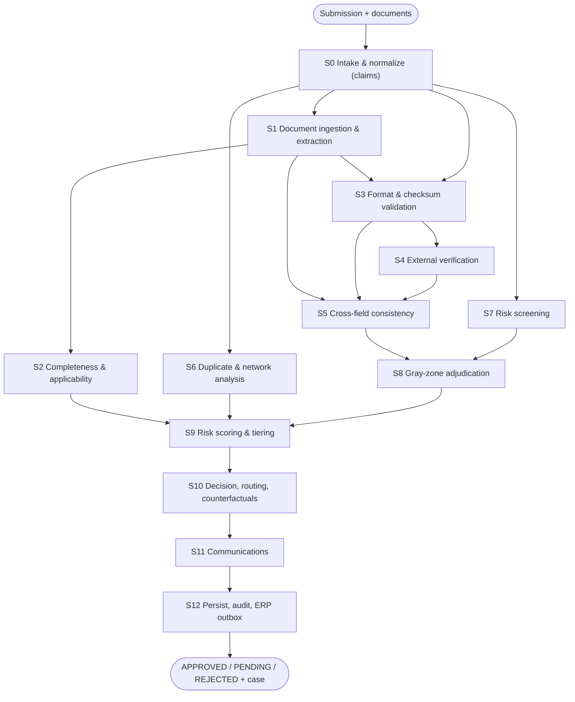

# Process map (WP-00; mirrors solution §5.2)

| Stage | Input | Decision | Output |
|---|---|---|---|
| S0 | submission JSON + files | mode NEW/CHANGE | claims, diff |
| S1 | documents | type/extract/ground | doc claims |
| S2 | policy requirements | complete? | MISSING_* |
| S3 | IDs | format/checksum? | TAX_*/BANK_* |
| S4 | IDs | verifier verdict? | VER_* (or UNVERIFIABLE) |
| S5 | names/geo | consistent? | NAME_*/GEO_* |
| S6 | master index | duplicate? | DUP_* |
| S7 | lists | hit? | SAN_* |
| S8 | gray requests | adjudicate (bounded) | WARN or stands |
| S9 | tags + facts | score/tier | RiskBreakdown |
| S10 | findings | decide/route | Decision |
| S11 | decision | render/check | outbox messages |
| S12 | all | persist/chain | audit + ERP outbox |
| S13 | resubmit/clock | delta/scheduler | rerun subset |
